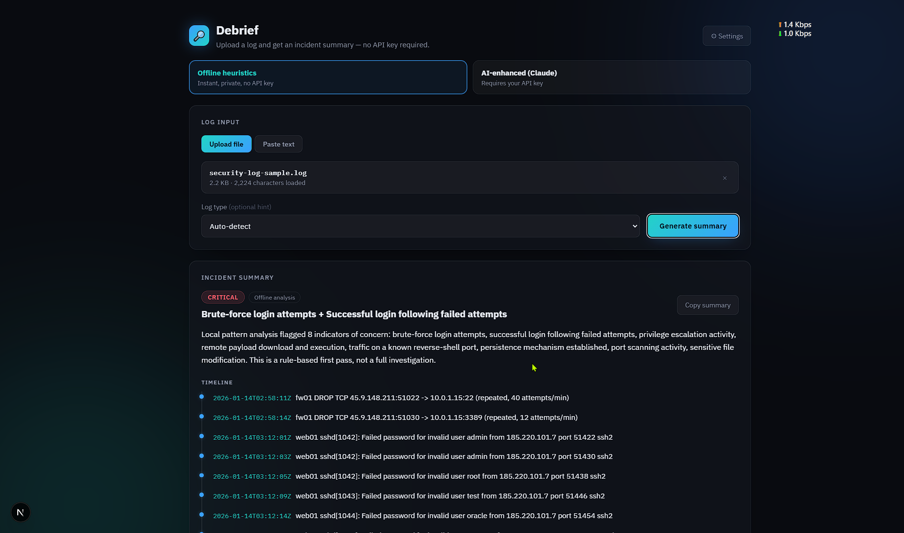

# Debrief — AI-Enhanced Vulnerability Log Summarizer

Upload a log file (or paste raw log text) and get back a structured incident
summary: severity, a plain-language explanation, a timeline of key events,
extracted indicators of compromise, and concrete next steps.



**Works out of the box with no API key** — an offline, rule-based analyzer
runs entirely in your browser. An optional AI-enhanced mode (Claude) is
available if you add your own Anthropic API key.

## Setup

```bash
npm install
npm run dev
```

Open http://localhost:3000 — that's it. No `.env` file, no API key, no
account needed to use Offline mode.

## Two analysis modes

### Offline heuristics (default)
A pattern-matching engine (`lib/heuristics.js`) scans the log for known
indicators — brute-force login attempts, privilege escalation, remote payload
download + execution, reverse-shell ports, persistence mechanisms (new cron
jobs, SSH keys), port scanning, and sensitive file modification — and builds
the same structured summary shape (severity, timeline, IOCs, recommended
actions) as AI mode. It runs synchronously in the browser: no data leaves
your machine, no network call is made, and no API key is needed.

This is a first-pass triage tool. It only recognizes the patterns it's
programmed to look for, so it won't catch novel or highly obfuscated
techniques.

### AI-enhanced (Claude)
For deeper, more nuanced analysis, add your own Anthropic API key via the
**⚙ Settings** button in the app. The key is stored in your browser's
`localStorage` only. When you run an AI-enhanced analysis, the key is sent to
this app's own server route (`/api/summarize`), which forwards it to
`api.anthropic.com` for that one request — it is never persisted
server-side or logged.

Get a key at https://console.anthropic.com/settings/keys. If you'd rather
configure a key once for everyone using a shared deployment instead of each
person entering their own, you can still set `ANTHROPIC_API_KEY` in
`.env.local` (copy `.env.local.example`) — the server falls back to that if
no per-request key is supplied.

Large logs are smartly truncated for the AI request (the beginning and end
are kept, with a note in the output if this happened) so oversized files
don't blow the request budget.

## Try it fast

A sample log is included at `sample-logs/ssh-brute-force.log` — drop it into
the upload zone. It's rich enough to light up several offline-mode rules
(brute force → successful login → privilege escalation → payload execution
→ persistence) without needing an API key at all.

## Project structure

```
app/
  layout.js                # root layout, loads fonts
  page.js                  # renders the LogSummarizer component
  globals.css              # dark theme, mode switch, settings modal
  api/summarize/route.js   # AI-mode only: calls the Anthropic API
lib/
  heuristics.js            # offline, no-key pattern-based analyzer
components/
  LogSummarizer.jsx        # upload/paste UI, mode switch, results, history
sample-logs/
  ssh-brute-force.log      # example log for a quick test run
```

## Notes

- Nothing is stored server-side in either mode — logs only exist in memory
  for the duration of a request (AI mode) or never leave the browser at all
  (Offline mode).
- Analysis history (last 10 runs) persists in the browser only
  (`localStorage`); it isn't synced anywhere.
- Styling is plain CSS (no Tailwind), so it's easy to drop into an existing
  design system.
- This is a triage aid, not a verdict — always confirm flagged incidents
  against your own logs and tooling before acting on them.
